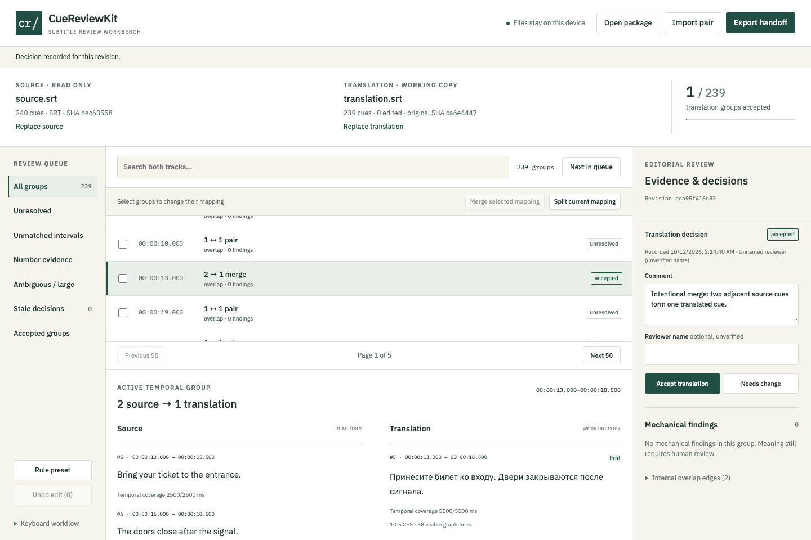

# CueReviewKit

**Review source and translated subtitles before delivery.**

A local subtitle workbench for translators and editors. Pair subtitles by real temporal overlap, inspect split/merge groups and uncovered intervals, record version-bound decisions, then hand off a package another editor can reopen.

[Try the app](https://mikonyaa.github.io/cuereviewkit/) · [Releases / offline ZIP](https://github.com/mikonyaa/cuereviewkit/releases) · [Demo recording](docs/demo/review-flow.webm) · [Sequential screenshots](docs/demo/sequence.json)



v0.1.0 is an experimental technical release. Mechanical checks do not certify translation accuracy, prove meaningful omissions, or establish compatibility with every delivery platform. No translation generation, paid models, accounts, telemetry, external fonts, or file uploads.

## Try a complete handoff

1. Import a source and translation pair, or choose **Try synthetic example**.
2. Inspect the explicit `1:1`, `1:n`, `n:1`, `n:m`, unmatched and ambiguous groups. Alignment uses half-open millisecond intervals; SRT numbering does not control correspondence.
3. Select the intentional 2 → 1 merge and accept the translation with an editorial comment. Check **Unmatched intervals** and **Number evidence** separately.
4. Use **Edit → Preview change → Apply correction** on the translation. Text or timing changes make **all earlier decisions stale**, even in other groups. Undo can restore the exact earlier data revision; history remains.
5. Export a **Review package**, **Reviewer report**, or **Corrected translation copy**. Corrected output is serialized and strictly reparsed before download. Originals remain byte-identical, and disk files are never overwritten.
6. Open the package in a clean browser session. The preview verifies schema, payload hashes, logical IDs and working bytes before replacing your view. Download your current package first. Imported HTML is never executed; reports are regenerated.

The original synthetic tram-guide example has **240 source / 239 translated cues**: 240 − 1 unmatched interval − 1 merge + 1 split = 239. It also includes `100 → 1000` evidence. [Independent expected manifest](examples/expected.json), [source](examples/source.srt), [translation](examples/translation.srt), [downloadable sample review package](examples/sample.cue-review.zip), [standalone report](https://mikonyaa.github.io/cuereviewkit/examples/report.html). The text was written for this project; it is not a client's subtitle file. The corpus contains 10 further synthetic pairs and 2,900 cues in total.

## Exact format subset

| Input | Supported in v1 |
| --- | --- |
| Encoding | Fatal UTF-8 decoding, optional UTF-8 BOM, LF or CRLF; no encoding guessing or Unicode normalization |
| SRT | Numeric cue number; `HH:MM:SS,mmm --> HH:MM:SS,mmm`; multiline text; blank separator. Hours may exceed 23. Repeated/gapped numbers are diagnosed and preserved. Empty cues and zero/reversed intervals are retained for repair. |
| WebVTT | `WEBVTT` header with optional same-line text; optional identifiers; `mm:ss.mmm` or `hh:mm:ss.mmm`; multiline payload; NOTE blocks. NOTE and identifiers are preserved verbatim. |
| Payload | Plain text and balanced, nested lowercase `b/i/u` tags without attributes. Display uses inert preformatted text, including literal tags. Recognized tags are excluded only from grapheme counting. |

Unsupported WebVTT STYLE, REGION, X-TIMESTAMP-MAP, positioning/settings, inline timestamps, voice/ruby/classes, unknown markup/entities and malformed structural fragments produce explicit diagnostics and **block corrected export of the affected document**. You can still inspect diagnostics and download untouched original bytes. This is a limited editor, **not full WebVTT conformance**. Mixed LF/CRLF fragments remain in the original; an edited fragment uses its existing timing-line newline convention. Lone CR is unsupported.

Edits do not insert/delete/reorder actual cues. Manual split/merge changes only correspondence. Only explicitly edited cue fragments are replaced. Unchanged numbers, surrounding separators, NOTE blocks and final newlines remain in place. Edited times use canonical `HH:MM:SS,mmm` (SRT) or `HH:MM:SS.mmm` (VTT). Blank separator lines inside an edited payload are rejected with a retained dialog draft. Edited files are not promised to be byte-identical.

## Review model and limitations

- Real overlap creates bipartite graph components. Near candidates use a separate configurable 200 ms boundary-distance tolerance only for unmatched positive intervals. Unique mutual choices are labelled `automatic-near`; ties remain ambiguous. Near matching adds no fictional coverage.
- Components exceeding 8 cues on either side or 30 seconds require manual review. Inspect edges, split into singleton unmatched groups, then select and merge the intended mapping. Every cue is accounted for exactly once.
- Coverage uses interval unions, so overlapping counterparts do not double count milliseconds. A temporal absence is different from a semantic omission. The app never automatically shifts a track.
- Structural findings include non-positive duration. Adjustable warnings include duration, overlapping cues within a track, empty text, missing/partial temporal coverage, CPS and numeric token differences. Intentional overlapping speakers can be waived separately from accepting a translation.
- CPS = visible **grapheme clusters**, including spaces but excluding line breaks and recognized tags, divided by positive duration in seconds. Uses `Intl.Segmenter`; unknown markup or unavailable segmentation is not computable. Default thresholds (400 ms minimum, 7 s maximum, 25 CPS, 90% coverage) are project presets, not universal language standards.
- Numbers use raw Unicode decimal tokens, without normalization. `100 → 1000` is visible. `1,000 / 1.000`, spaces and localized digits request human interpretation. Words, units, dates and meaning are beyond this rule.
- Review revision hashes both original byte hashes, working translation, complete mapping, engine/rule versions and configuration/locale. Decisions also contain a subject hash. Replacing a different track, editing, changing mapping or settings invalidates earlier approvals. Reviewer names are unverified local labels; history is not a tamper-proof legal audit.

## Privacy, storage and limits

All parsing, hashing, matching, rules and ZIP operations run in a cancellable local worker. Cancellation terminates that worker; stale request/revision responses cannot replace newer data. No user file is sent to a server. The built-in example is fetched from the same origin only when requested. Hosted app assets are served normally by GitHub Pages.

IndexedDB keeps one atomic recovery snapshot per origin. A compare-and-swap token prevents two tabs from silently overwriting a newer recovery. Failed/quota/conflict states remain visible and package export still works. Recovery is **not a portable backup**. Changing a local port changes the origin; clearing browser data loses recovery. Unapplied text/comment drafts are not committed recovery. No unrelated storage keys are cleared.

| Bound | Limit |
| --- | --- |
| Track bytes / cues | 10 MiB / 20,000 per track |
| Lines / format diagnostics | 400,000 / 100,000 per track, rejected before unbounded materialization |
| Cue text / comment / reviewer | 20,000 / 2,000 / 100 characters |
| Alignment edges / near candidates | 200,000 each; controlled incomplete result on overflow |
| ZIP | 30 MiB compressed, 60 MiB actually unpacked, exactly 6 allowlisted files, ratio ≤200 |
| JSON | Manifest 32 KiB; review 20 MiB; depth/node limits; unsafe prototype keys rejected |
| History / undo | Last 200 journal entries / 30 data snapshots |
| Decisions | At most 60,000 retained records; package limits also apply |
| UI materialization | 50 groups, 50 cues per track and 50 findings per page; explicit pagination |

ZIP traversal, absolute paths, duplicate names, nested archives, encryption, symlinks, unsupported compression, contradictory headers, CRC failures and actual decompression overruns are rejected. Legitimately repetitive exported data uses stored ZIP entries when compression would exceed the import ratio limit. [Package specification](docs/package-spec.md).

## Keyboard and browsers

`j` / `k`: next / previous group. `n`: next in the current queue (choose **Unresolved** first). `e`: edit the first translated cue. `a`: accept the current group. `u`: undo. `/`: search. Keys are disabled in input fields and dialogs. Tab/Shift+Tab stay inside a dialog; Escape closes it while idle. Source cues remain read only.

Chromium, Firefox and Playwright WebKit pass the same real browser flows on macOS. WebKit testing is **not a real Safari-device test**. 1440, 1024 and 390 px viewports, RTL/CJK, long text, unsupported formats and empty pairs are exercised. Exact tested versions and measured performance are in [QA evidence](docs/qa.md). No iPhone/Android physical-device validation or external translator pilot is claimed.

## Offline start

Download the web ZIP from [Releases](https://github.com/mikonyaa/cuereviewkit/releases), unpack, then run with Node.js 24 LTS:

```sh
node serve.mjs --port 0
```

Open the printed loopback URL. No `npm install` is needed. Only `127.0.0.1` is listened on; port 0 chooses an available port. The **editor requires HTTP**; `file://app/index.html` is not supported. The standalone **report.html works via file://**. There is no service worker or promise of cached Pages availability while offline. [Offline guide](README-OFFLINE.md).

## Development and tests

Node 24.21.0 LTS; exact dependency versions and npm lockfile. Browser installation is a separate step:

```sh
npm ci
npx playwright install chromium firefox webkit
# On Linux CI: npx playwright install --with-deps chromium firefox webkit
npm run dev -- --host 127.0.0.1
npm run typecheck
npm run lint
npm run test:unit
npm run build
npm run test:e2e
npm run package:web
npm run test:production
npm run demo:record
```

The dev server also selects a free port. E2E servers use port 0 and fresh browser contexts; they do not reuse ordinary browser profiles or stop unrelated processes. `test:production` unpacks the **final ZIP outside the source workspace** and completes a consumer flow using its dependency-free server. CI repeats installation, lint/typecheck, unit tests, all three browser engines, build, package and consumer checks. Pages uses only the same tested `app/` tree. Release assets identify their source commit and build origin; hashes establish payload integrity, not reviewer authorship.

## Troubleshooting and scope

An encoding/unsupported diagnostic blocks corrected export: download the original, convert a separate copy with an appropriate external tool, then import it. A blank-line draft error means the text would create a new structural block: remove separator lines inside the payload and preview again. A storage conflict means another tab saved later: download this tab's package and reopen deliberately; there is no automatic history merge. An incomplete graph means the edge budget was reached: originals and an explicitly incomplete report remain available; decisions cannot be recorded until the data/mapping can be fully analyzed.

No local video player, global-offset preview, ASS/SSA, speech recognition, automatic translation, semantic grading, cloud collaboration, ffmpeg pipeline or nonlinear video editor in v1. External translator usability pilots are future work. [Competitor comparison](docs/comparison.md) describes one small executed core handoff without asserting market demand or unverified product absence.

[Contributing](CONTRIBUTING.md) · [Security](SECURITY.md) · [Changelog](CHANGELOG.md) · [MIT License](LICENSE) · [Third-party notices](THIRD_PARTY_NOTICES.md)
